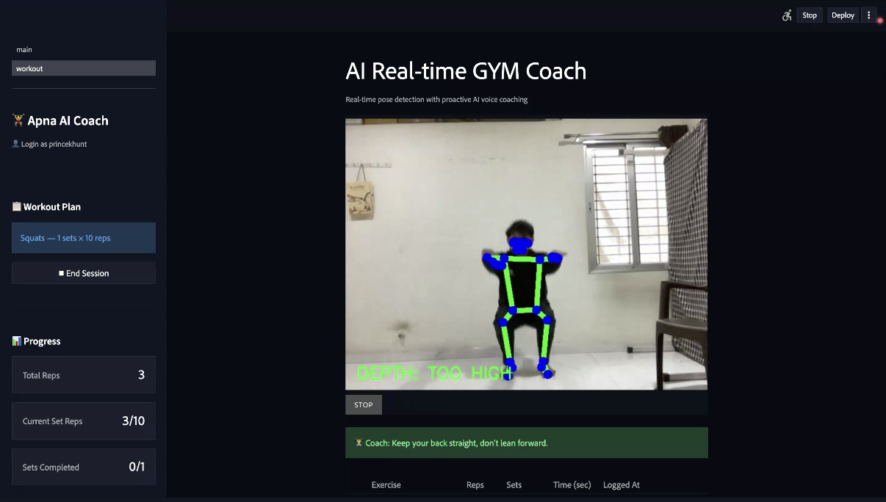
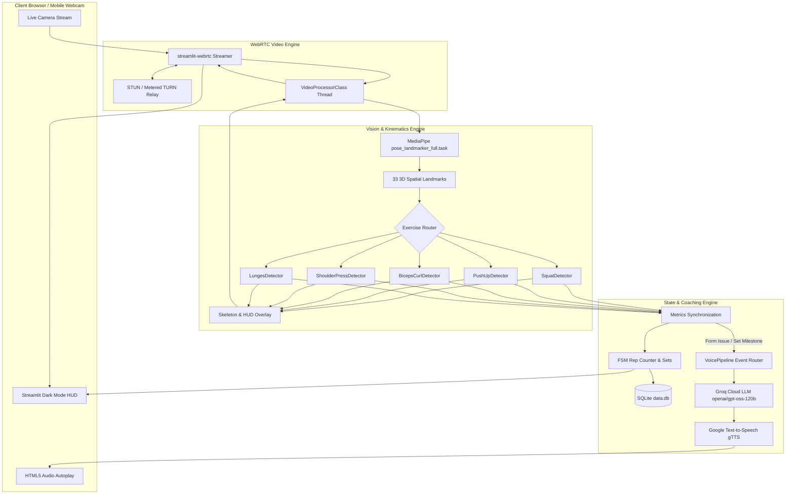
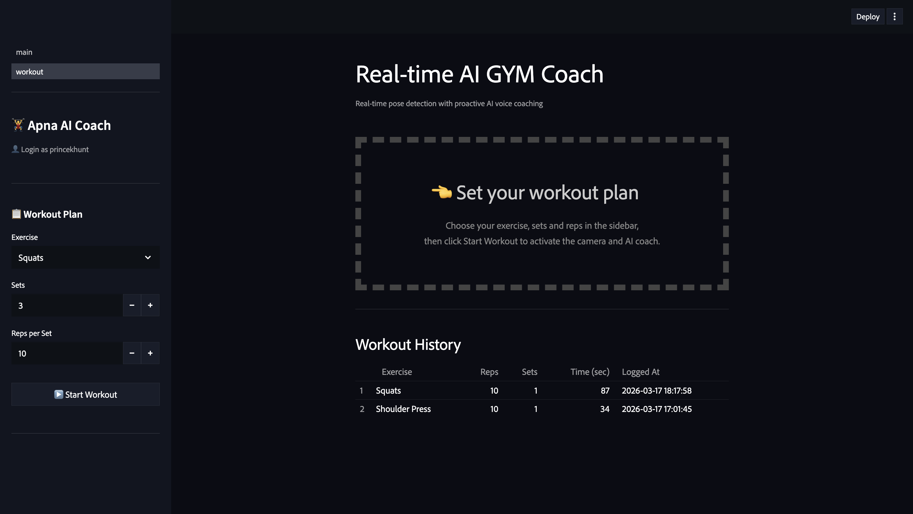
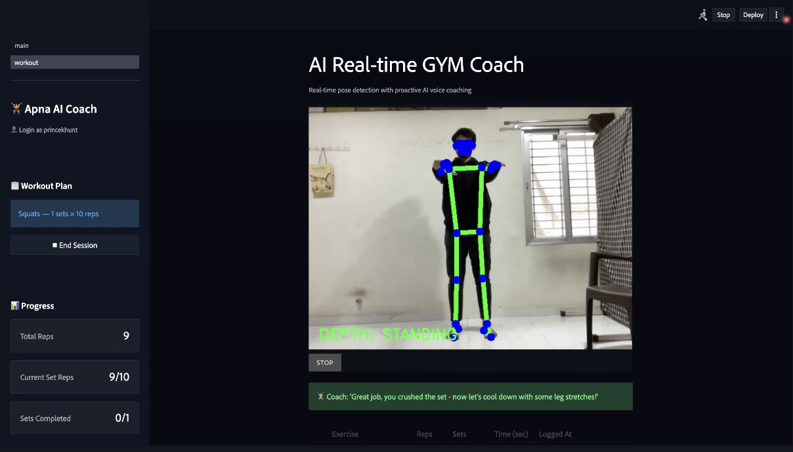
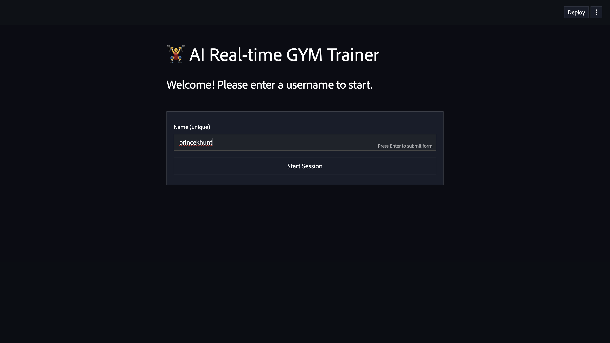
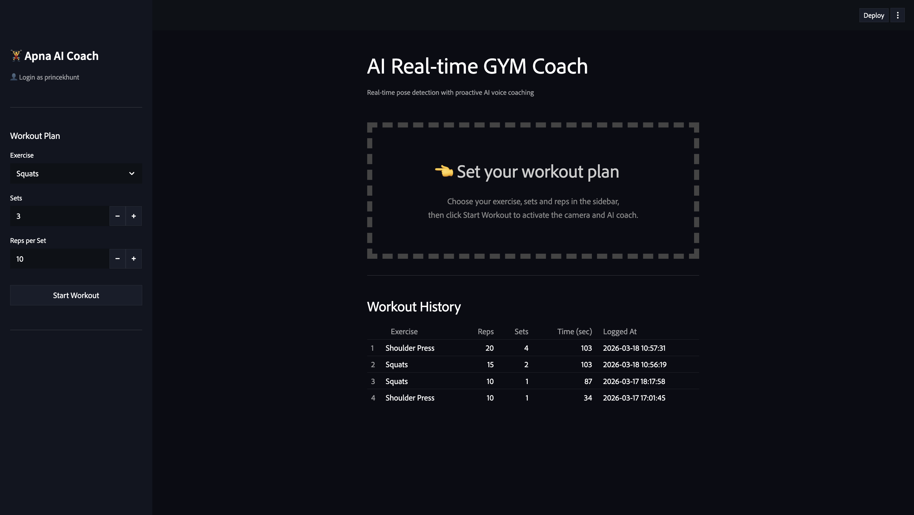
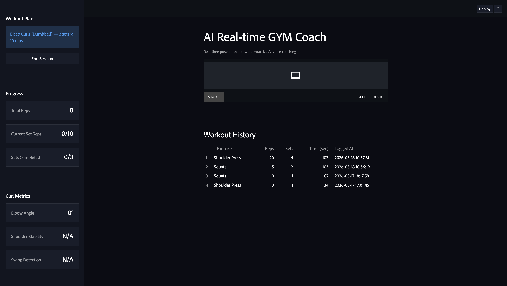

# 🏋️‍♂️ Apna AI Gym Coach — Real-Time Computer Vision & Voice Workout Trainer

<div align="center">

[](https://ai-realtime-gym-coach-prashil.streamlit.app/)
[](https://developers.google.com/mediapipe)
[](https://opencv.org/)
[](https://groq.com/)
[](https://github.com/whitphx/streamlit-webrtc)
[](https://www.python.org/)
[](https://www.sqlite.org/)
[](LICENSE)

<br/>

**Transform any webcam into an Olympic-grade personal biomechanics coach.**  
*Instant joint angle tracking, strict rep state validation, and proactive audio coaching in under 60ms — zero wearables required.*

<br/>

[🚀 Launch Live App](https://ai-realtime-gym-coach-prashil.streamlit.app/) • [📸 Interface Showcase](#-interface-showcase--visual-tour) • [📐 Biomechanical Kinematics](#-biomechanical-kinematics--mathematical-models) • [⚙️ Architecture](#-system-architecture) • [🛠️ Getting Started](#-installation--local-setup) • [👨‍💻 Developer](#-developer--contact)

<br/>



</div>

---

## 📌 Table of Contents

- [Overview](#-overview)
- [Key Features](#-key-features)
- [System Architecture](#-system-architecture)
- [Biomechanical Kinematics & Mathematical Models](#-biomechanical-kinematics--mathematical-models)
- [Supported Exercise Modalities & Fault Detection](#-supported-exercise-modalities--fault-detection)
- [Proactive AI Voice Coaching Pipeline](#-proactive-ai-voice-coaching-pipeline)
- [Interface Showcase & Visual Tour](#-interface-showcase--visual-tour)
- [Repository Directory Structure](#-repository-directory-structure)
- [Installation & Local Setup](#-installation--local-setup)
- [Streamlit Cloud Deployment & WebRTC TURN Setup](#-streamlit-cloud-deployment--webrtc-turn-setup)
- [Database Schema & Analytics](#-database-schema--analytics)
- [Roadmap](#-future-roadmap)
- [Developer & Contact](#-developer--contact)
- [License](#-license)

---

## 💡 Overview

Exercising with incorrect form causes acute ligament strain, long-term spinal degradation, and reduces muscular hypertrophy. However:
- **Gym mirrors** only provide 2D frontal reflections, forcing lifters to crane their necks and break neutral spine alignment.
- **Personal trainers** cost \$50–\$150/hour and cannot quantitatively calculate spatial joint degrees in real time.
- **Fitness wearables** only monitor heart rate and wrist accelerations, completely blind to knee valgus, lumbar rounding, or shallow rep depth.

**Apna AI Gym Coach** solves this problem by turning any standard webcam or smartphone camera into an intelligent biomechanics coach. Running **Google MediaPipe's** 33-landmark 3D pose detection model inside an asynchronous WebRTC video processing pipeline, the system:
1. Calculates real-time 3D joint angles using dot product vector trigonometry at **30+ FPS**.
2. Evaluates form stability (e.g. torso swing, elbow drift, hip sagging, lumbar arching, balance).
3. Drives a deterministic **Finite State Machine (FSM)** that only awards reps for full range-of-motion.
4. Synthesizes sharp, natural, 10–15 word voice corrections using **Groq Cloud LLMs** and **Google Text-to-Speech (gTTS)** before injuries happen.
5. Records comprehensive sets, reps, and time metrics to a local **SQLite** database for chronological progress visualization.

---

## ⚡ Key Features

| Capability | Description |
| :--- | :--- |
| **Sub-60ms Kinematic Tracking** | Tracks 33 full-body anatomical spatial landmarks with high confidence filtering ($\ge 0.7$) using MediaPipe PoseLandmarker. |
| **Strict FSM Rep Counter** | Rejects half-reps, bouncing, or cheating momentum. Reps only increment upon full turnaround through designated eccentric and concentric angles. |
| **Proactive AI Voice Coaching** | Integrates an intelligent event-driven pipeline powered by Groq (`openai/gpt-oss-120b`) and gTTS for human-like vocal cues. |
| **5 Biomechanical Exercises** | Out-of-the-box support for Squats, Push-ups, Dumbbell Bicep Curls, Overhead Shoulder Press, and Walking Lunges. |
| **Form Breakdown Telemetry** | Real-time heads-up display (HUD) showing knee depth status, hip alignment, spinal arch, elbow flaring, and lateral body sway. |
| **Zero Wearables Needed** | Operates strictly via optical computer vision — no smartwatch, chest strap, or markers required. |
| **Robust WebRTC STUN/TURN** | Native support for cloud container traversal using case-insensitive Metered.ca dynamic API key fetching or static TURN relay configs. |
| **Athlete Profile & Analytics** | SQLite persistence recording chronological sets, reps, workout duration, and date-aggregated volume charts. |

---

## 🏗️ System Architecture

The application is structured into decoupled services separating computer vision ingestion, kinematics analysis, stateful metric tracking, persistent storage, and generative voice feedback.



---

## 📐 Biomechanical Kinematics & Mathematical Models

### 1. Vector Joint Angle Calculation (Trigonometric Cosine Rule)

To calculate the spatial flex angle between three connected anatomical keypoints $A(x_1, y_1)$, $B(x_2, y_2)$ (vertex/joint), and $C(x_3, y_3)$:

$$\vec{u} = \vec{BA} = \begin{bmatrix} x_1 - x_2 \\ y_1 - y_2 \end{bmatrix}, \quad \vec{v} = \vec{BC} = \begin{bmatrix} x_3 - x_2 \\ y_3 - y_2 \end{bmatrix}$$

$$\vec{u} \cdot \vec{v} = (x_1 - x_2)(x_3 - x_2) + (y_1 - y_2)(y_3 - y_2)$$

$$\|\vec{u}\| = \sqrt{(x_1 - x_2)^2 + (y_1 - y_2)^2}, \quad \|\vec{v}\| = \sqrt{(x_3 - x_2)^2 + (y_3 - y_2)^2}$$

$$\theta = \arccos\left(\text{clamp}\left(\frac{\vec{u} \cdot \vec{v}}{\|\vec{u}\| \|\vec{v}\|}, -1.0, 1.0\right)\right) \times \frac{180^\circ}{\pi}$$

> Implemented in [core/base_exercise.py](file:///d:/Prime%20AI%20ML/Apna%20College/Projects/AI-Realtime-GYM-Coach/core/base_exercise.py) with floating-point safety clamping to eliminate computational domain errors.

---

### 2. Push-up Hip Sag Displacement Formula

In a proper push-up plank, the hips must remain on the direct collinear axis between shoulders and ankles:

$$y_{\text{expected}} = \frac{y_{\text{shoulder}} + y_{\text{ankle}}}{2}$$

$$\Delta y_{\text{hip}} = y_{\text{hip}} - y_{\text{expected}}$$

$$\text{Status} = \begin{cases} 
\text{LEVEL} & \text{if } |\Delta y_{\text{hip}}| \le 0.08 \\
\text{SAGGING} & \text{if } \Delta y_{\text{hip}} > 0.08 \quad (\text{Lumbar anterior tilt}) \\
\text{PIKED UP} & \text{if } \Delta y_{\text{hip}} < -0.08 \quad (\text{Posterior hip pike})
\end{cases}$$

---

### 3. Bicep Curl Torso Sway & Momentum Model

Torso momentum cheating during dumbbell curls is tracked by computing the angular inclination of the shoulder-hip line relative to true vertical:

$$\Delta x = \bar{x}_{\text{shoulders}} - \bar{x}_{\text{hips}}, \quad \Delta y = \bar{y}_{\text{shoulders}} - \bar{y}_{\text{hips}}$$

$$\theta_{\text{swing}} = \arctan\left(\frac{|\Delta x|}{|\Delta y|}\right) \times \frac{180^\circ}{\pi}$$

$$\text{Status} = \begin{cases}
\text{NO SWING} & \text{if } \theta_{\text{swing}} \le 15^\circ \\
\text{SWINGING} & \text{if } \theta_{\text{swing}} > 15^\circ \quad (\text{Cheating with hip thrust})
\end{cases}$$

---

## 🏋️‍♂️ Supported Exercise Modalities & Fault Detection

| Exercise | Primary Joint Angle | Down Threshold | Up Threshold | Additional Form Checks |
| :--- | :--- | :---: | :---: | :--- |
| **Squats** | Hip $\to$ Knee $\to$ Ankle | $< 100^\circ$ (Deep/Parallel) | $\ge 160^\circ$ (Full Stand) | • Depth status verification (`GOOD DEPTH` vs `TOO HIGH`)<br/>• Torso lean angle ($< 130^\circ$ flags good-morning fault) |
| **Push-ups** | Shoulder $\to$ Elbow $\to$ Wrist | $< 90^\circ$ (Chest to Deck) | $> 160^\circ$ (Plank Lockout) | • Body alignment angle ($> 160^\circ$ Straight, $\le 140^\circ$ Poor Form)<br/>• Hip sag/pike offset ($\pm 0.08$ tolerance) |
| **Bicep Curls** | Shoulder $\to$ Elbow $\to$ Wrist | $> 160^\circ$ (Full Extension) | $< 50^\circ$ (Peak Flexion) | • Elbow drift tolerance ($|X_e - X_s| \le 0.06$)<br/>• Torso vertical swing angle ($\le 15^\circ$) |
| **Shoulder Press**| Shoulder $\to$ Elbow $\to$ Wrist | $< 90^\circ$ (Shoulder Level) | $> 160^\circ$ (Overhead Lockout) | • Extension progression (Full, Nearly, Pressing)<br/>• Lumbar back arch angle ($< 140^\circ$ excessive arch) |
| **Walking Lunges**| Hip $\to$ Front Knee $\to$ Ankle | $< 100^\circ$ (Lead Knee Lunge)| $> 160^\circ$ (Standing Recovery)| • Torso angle from hip plane<br/>• Lateral balance offset ($|X_s - X_h| \le 0.10$) |

---

## 🔊 Proactive AI Voice Coaching Pipeline

Unlike dumb counters that only beep after a set, Apna AI Gym Coach delivers **intelligent conversational voice coaching**:

1. **Rule-Based Form Sentry**: Detects mechanical flaws (e.g., hips sagging on push-ups, elbow drifting on curls, or depth cutting on squats).
2. **Contextual Event Dispatcher**: Emits structured events:
   - `workout_started`: Energetic start command.
   - `ongoing_form_check`: Immediate corrective cue.
   - `set_completed`: Sets target praise and breather reminder.
   - `workout_completed`: Session accomplishment summary.
   - `no_pose_detected`: Audible camera positioning guide.
3. **Groq Cloud LLM (`openai/gpt-oss-120b`)**: Converts the event and technical diagnostic into a natural, motivating 10–15 word cue with sub-300ms time-to-first-token.
4. **Non-Blocking gTTS Synthesizer**: Converts text to MP3 audio bytes streamed directly to the browser with zero UI stutter.
5. **Cooldown Rate Limiting**: Enforces a 5-second interval between proactive form reminders to prevent coaching fatigue.

---

## 📸 Interface Showcase & Visual Tour

<div align="center">

| Step 01: Setup & Exercise Selection | Step 02: Real-time Squat Depth Warning |
| :---: | :---: |
|  |  |
| *Select exercise, target sets, reps, and inspect previous history* | *Instant visual feedback & audio alert when depth is cut short* |

| Step 03: Rep Completion & Verification | Step 04: Athlete Authentication Wall |
| :---: | :---: |
|  |  |
| *Full extension verified (178°) with dynamic motivational cue* | *Frictionless username-based login session tracking* |

| Step 05: Chronological Workout History | Step 06: Bicep Curl Kinematics & WebRTC |
| :---: | :---: |
|  |  |
| *Historical analytics logging reps, sets, and elapsed time* | *Continuous telemetry with camera input dropdown & TURN status* |

</div>

---

## 📁 Repository Directory Structure

```plaintext
AI-Realtime-GYM-Coach/
├── .devcontainer/                # VS Code Dev Container configuration
│   └── devcontainer.json
├── .streamlit/                   # Streamlit UI theme configuration
│   └── config.toml
├── assets/                       # UI screenshots and visual documentation
│   ├── i1.png
│   ├── i2.png
│   ├── i3.png
│   ├── i4.png
│   ├── i5.png
│   └── i6.png
├── core/                         # Core biomechanical abstractions
│   ├── __init__.py
│   └── base_exercise.py          # Abstract base class & cosine angle math
├── detectors/                    # Exercise-specific kinematic detectors
│   ├── __init__.py
│   ├── biceps_curl.py            # Curl detector (elbow drift, torso swing)
│   ├── lunges.py                 # Lunge detector (knee angle, balance)
│   ├── pushup.py                 # Push-up detector (alignment, hip sag)
│   ├── shoulder_press.py         # Press detector (extension, back arch)
│   └── squat.py                  # Squat detector (depth, torso angle)
├── ml_models/                    # MediaPipe pre-trained vision models
│   ├── __init__.py
│   └── pose_landmarker_full.task # Google MediaPipe full 33-pose task model
├── services/                     # Application services layer
│   ├── __init__.py
│   ├── auth/                     # Authentication & login gate
│   │   └── login_wall.py
│   ├── coaching/                 # Generative AI voice coaching
│   │   ├── llm.py                # Groq Cloud LLM completion handler
│   │   ├── tts.py                # Google Text-to-Speech audio generator
│   │   └── voice_pipeline.py     # Event-driven coaching coordinator
│   ├── config/                   # System configurations
│   │   ├── webrtc_config.py      # Case-insensitive STUN/TURN ICE config
│   │   └── workout_config.py     # Exercise definitions, landmarks, prompt
│   ├── persistence/              # SQLite database storage & queries
│   │   └── exercise_repository.py
│   ├── state/                    # Streamlit session defaults
│   │   └── session_default.py
│   ├── tracking/                 # Metrics synchronization & set tracking
│   │   └── metrics.py
│   ├── ui/                       # CSS loader & typography injectors
│   │   └── style_loader.py
│   └── vision/                   # WebRTC video frame processor
│       └── exercise_video_processor.py
├── static/                       # Static web styling & local fonts
│   ├── AdobeClean.otf            # Premium custom typography font
│   └── style.css                 # Custom glassmorphic CSS styling
├── .env.example                  # Environment configuration template
├── .gitignore                    # Git ignore file
├── data.db                       # SQLite database for workouts and users
├── main.py                       # Main Streamlit web application entrypoint
├── packages.txt                  # Linux Debian system dependencies
├── requirements.txt              # Python library dependencies
├── LICENSE                       # MIT License
└── README.md                     # Comprehensive project documentation
```

---

## 🛠️ Installation & Local Setup

### Prerequisites

- **Python**: Version `3.10` or higher (`3.10`–`3.12` recommended)
- **Webcam**: Standard USB or built-in laptop camera
- **Groq API Key**: Free API key from [Groq Cloud Console](https://console.groq.com/)

---

### Step 1: Clone Repository

```bash
git clone https://github.com/PD1526Patel/AI-Realtime-GYM-Coach.git
cd AI-Realtime-GYM-Coach
```

---

### Step 2: Create and Activate Virtual Environment

**Windows (PowerShell):**
```powershell
python -m venv .venv
.\.venv\Scripts\Activate.ps1
```

**macOS / Linux:**
```bash
python3 -m venv .venv
source .venv/bin/activate
```

---

### Step 3: Install Linux System Dependencies *(Linux/WSL only)*

If running on Ubuntu, Debian, or WSL:
```bash
sudo apt-get update
sudo apt-get install -y libgl1 libglib2.0-0 libsm6 libxext6
```

---

### Step 4: Install Python Dependencies

```bash
pip install --upgrade pip
pip install -r requirements.txt
```

---

### Step 5: Configure Environment Variables

Create a `.env` file in the project root:

```bash
cp .env.example .env
```

Open `.env` and insert your Groq API key:
```env
GROQ_API_KEY="gsk_your_groq_api_key_here"
```

---

### Step 6: Launch Application

```bash
streamlit run main.py
```

Open your browser at `http://localhost:8501`. Enter your name, choose an exercise from the sidebar, grant webcam permission, and begin your workout!

---

## 🌐 Streamlit Cloud Deployment & WebRTC TURN Setup

When deploying WebRTC applications on cloud containers (such as Streamlit Cloud, Render, or AWS EC2), direct peer-to-peer UDP connections frequently fail due to cloud firewall NAT barriers. A **TURN relay server** is required.

This repository includes a smart case-insensitive ICE configuration engine in [services/config/webrtc_config.py](file:///d:/Prime%20AI%20ML/Apna%20College/Projects/AI-Realtime-GYM-Coach/services/config/webrtc_config.py).

### Setting up Secrets in Streamlit Cloud

1. Deploy your repository at [share.streamlit.io](https://share.streamlit.io/).
2. In your app settings, navigate to **Settings** ➔ **Secrets**.
3. Add your credentials using either of these two options:

#### Option A: Metered.ca Dynamic API Key (Recommended)
Sign up for a free TURN relay account at [metered.ca](https://www.metered.ca/):

```toml
GROQ_API_KEY = "gsk_your_groq_api_key"
METERED_DOMAIN = "yourdomain.metered.live"
METERED_API_KEY = "your_metered_api_key"
```

#### Option B: Static TURN Credentials

```toml
GROQ_API_KEY = "gsk_your_groq_api_key"
turn_url = "turn:global.relay.metered.ca:80"
turn_username = "your_username"
turn_password = "your_password"
```

*Reboot the app after updating secrets. The top of the video container will display a green `🟢 WebRTC Relay Active` status badge.*

---

## 🗄️ Database Schema & Analytics

Apna AI Gym Coach uses a lightweight, self-contained **SQLite3** database (`data.db`) managed via [services/persistence/exercise_repository.py](file:///d:/Prime%20AI%20ML/Apna%20College/Projects/AI-Realtime-GYM-Coach/services/persistence/exercise_repository.py):

### 1. `users` Table
Stores unique athlete profiles for session tracking:
```sql
CREATE TABLE IF NOT EXISTS users (
    id          INTEGER PRIMARY KEY AUTOINCREMENT,
    username    TEXT UNIQUE NOT NULL,
    created_at  TIMESTAMP DEFAULT CURRENT_TIMESTAMP
);
```

### 2. `exercises` Table
Aggregates workout volume, completed sets, verified reps, and elapsed time per exercise per day:
```sql
CREATE TABLE IF NOT EXISTS exercises (
    id            INTEGER PRIMARY KEY AUTOINCREMENT,
    user_id       INTEGER NOT NULL REFERENCES users(id),
    exercise_name TEXT NOT NULL,
    reps          INTEGER NOT NULL DEFAULT 0,
    sets          INTEGER NOT NULL DEFAULT 0,
    time          INTEGER NOT NULL DEFAULT 0,
    created_at    TIMESTAMP DEFAULT CURRENT_TIMESTAMP
);
```

---

## 🗺️ Future Roadmap

- [x] High-precision 33-landmark 3D pose detection with MediaPipe.
- [x] Mathematical joint angle vector calculations with zero wearables.
- [x] Deterministic FSM state machine for rep & set validation.
- [x] Proactive conversational voice coaching via Groq LLM + gTTS.
- [x] Dynamic WebRTC TURN relay integration for cloud streaming.
- [x] SQLite workout analytics ledger.
- [ ] Multi-person tracking mode for group gym classes.
- [ ] Barbell velocity tracking and concentric path drift analysis.
- [ ] On-device offline LLM inference via Ollama / Gemma 2B.
- [ ] Mobile companion app (PWA) with Apple Health & Google Fit synchronization.

---

## 👨‍💻 Developer & Contact

Crafted with dedication by **Kagathara Prashil**. Open to discussions, collaborations, and opportunities in Machine Learning Engineering, Computer Vision, and AI-driven products.

<div align="left">

[](https://www.linkedin.com/in/prashilkumar-kagathara/)
[](https://github.com/PD1526Patel)
[](https://leetcode.com/u/PD_Patel_1526/)
[](mailto:kagatharaprashilkumar1526@gmail.com)

</div>

---

## 📄 License

This project is licensed under the [MIT License](LICENSE) — feel free to use, modify, and distribute it for personal and commercial fitness applications.

<div align="center">
  <sub>Built with ❤️, OpenCV, MediaPipe, Streamlit, and Groq Cloud. ⭐ Star this repository if it helped your training!</sub>
</div>
